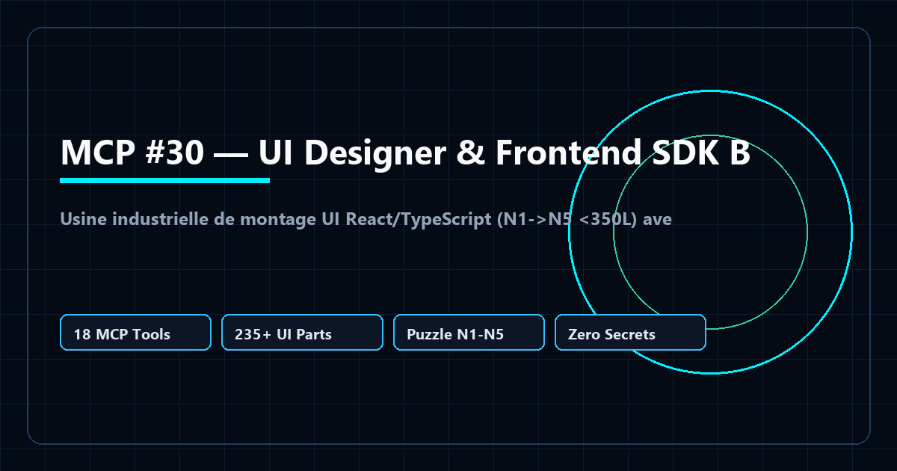
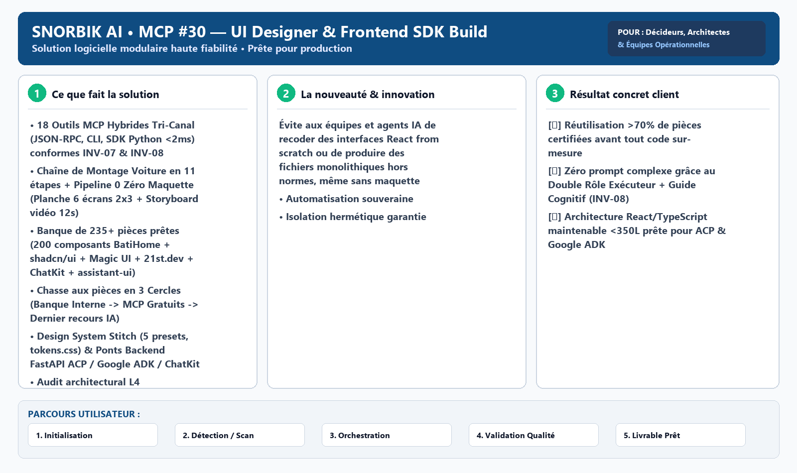
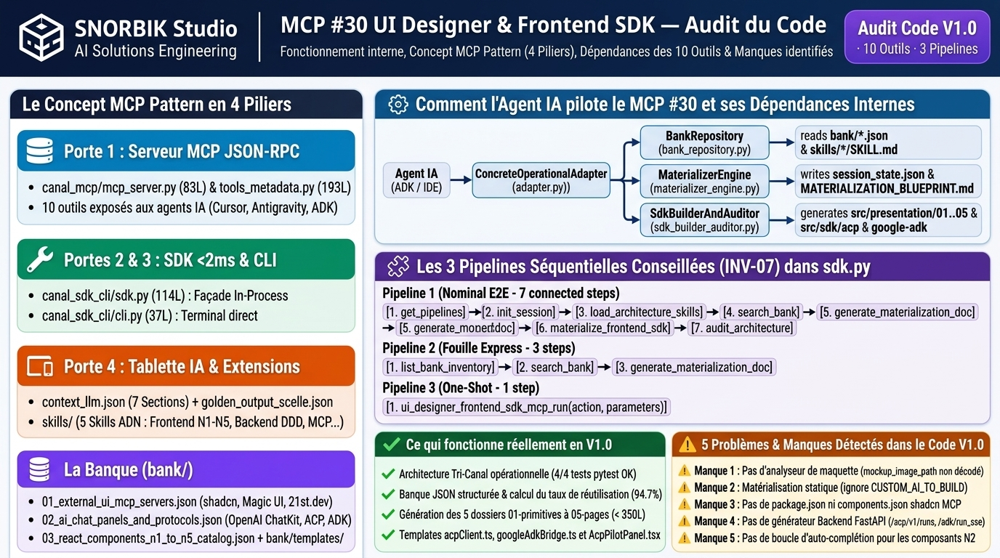
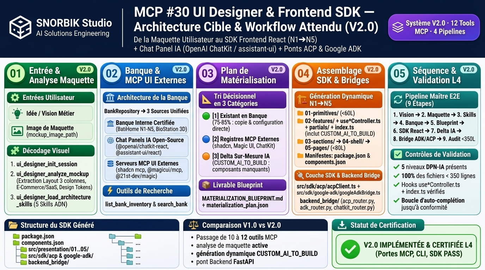

# 🎨 MCP #30 — UI Designer & Frontend SDK Builder (`V3.0.0`)



> **Usine Industrielle de Montage UI React/TypeScript & SDK Agents IA** (`ACP`, `Google ADK`, `OpenAI ChatKit`, `assistant-ui`, `AG-UI`) respectant strictement l'**Architecture en Puzzle à 5 Niveaux (`N1 ➔ N5`)**, le plafond **`< 350 lignes/fichier`**, la **Chasse aux Pièces en 3 Cercles** et la méthode **SNORBIK « AI Visual Prototyping »** (*Zéro Maquette*).

---

## 📊 1. Vue Visuelle & Infographies SNORBIK Studio

### A. Infographie Commerciale & Valeur Métier (Showcase)


### B. Audit V1.0 vs Architecture Cible V2.0/V3.0



👉 Étude détaillée : [`docs/01_ETUDE_CODE_ET_COMPARAISON_V1_VS_V2.md`](docs/01_ETUDE_CODE_ET_COMPARAISON_V1_VS_V2.md) · Doctrine `INV-07 / INV-08` : [`docs/DOCTRINE_PIPELINES_SEQUENTIELLES.md`](docs/DOCTRINE_PIPELINES_SEQUENTIELLES.md) · Vitrine publique : [`README_SHOWCASE.md`](README_SHOWCASE.md).

---

## 🛠️ 2. Catalogue Complet des 18 Outils MCP (`canal_mcp/tools_metadata.py`)

Tous les outils respectent le standard **Quinti-Bloc Bipartite (`INV-07`)** et le **Double Rôle Exécuteur Déterministe + Guide Cognitif (`INV-08`)** :

| # | Outil MCP | Rôle & Fonctionnement | Sortie / Artefact |
| :--- | :--- | :--- | :--- |
| 1 | `ui_designer_frontend_sdk_mcp_ping` | Sonde de santé mémoire vive (`< 1 ms`) | `HEALTHY` · `3.0.0` |
| 2 | `ui_designer_frontend_sdk_mcp_get_pipelines` | Boussole retournant les **5 pipelines séquentielles conseillées** | Catalogue des 5 pipelines |
| 3 | `ui_designer_init_session` | Crée la session, enregistre vision, maquette et protocoles IA | `session_state.json` |
| 4 | `ui_designer_qualify_and_plan_pages` | Qualifie l'archétype, les pages, leur contenu et séquences | `PAGES_AND_SEQUENCES_SPEC.md` |
| 5 | `ui_designer_extract_design_system` | Extrait/génère le thème **Stitch** (polices, fond, palette) | `tokens.css` & `DESIGN_SYSTEM_STITCH.md` |
| 6 | `ui_designer_analyze_mockup` | Analyse complémentaire du layout et des zones UI d'une maquette | Mapping `DPN-IA N1->N5` |
| 7 | `ui_designer_load_architecture_skills` | Charge les **6 Skills ADN** (`N1->N5`, `<350L`, DDD, Tri-Canal, Prototypage) | Règles architecturales actives |
| 8 | `ui_designer_decompose_n1_to_n5` | Dresse la liste complète des pièces requises de `01-primitives` à `05-pages` | Liste structurée `N1->N5` |
| 9 | `ui_designer_hunt_parts_3_circles` | Exécute la **Chasse aux Pièces en 3 Cercles** avant tout code | Taux de réutilisation (%) & provenance |
| 10 | `ui_designer_list_bank_inventory` | Inventaire complet du magasin de pièces (`235+` pièces) | Compteurs & registres |
| 11 | `ui_designer_search_bank` | Recherche ciblée par mots-clés, features et protocoles | Composants & connecteurs matchés |
| 12 | `ui_designer_generate_materialization_doc` | Produit le blueprint d'assemblage chiffré | `MATERIALIZATION_BLUEPRINT.md` & `.json` |
| 13 | `ui_designer_materialize_frontend_sdk` | Génère `package.json`, `components.json`, `tokens.css`, `N1->N5`, `src/sdk/` + delta | Arborescence SDK React prête |
| 14 | `ui_designer_generate_backend_bridge` | Génère les routeurs FastAPI Clean DDD (`ACP`, `Google ADK`, `ChatKit`) | `interfaces/acp_router.py`, `adk_router.py`, `chatkit_router.py` |
| 15 | `ui_designer_audit_architecture` | Audit L4 : 5 niveaux `N1->N5`, `use*Controller.ts`, `index.ts`, `< 350L` | Certificat de conformité L4 |
| 16 | `ui_designer_generate_phase1_design_prompt` | **Zéro Maquette — Phase 1 :** Prompt planche `16:9` (6 écrans `2×3`) | `P1_DESIGN_PROMPT.md` |
| 17 | `ui_designer_generate_phase2_video_prompt` | **Zéro Maquette — Phase 2 :** Storyboard vidéo `12s` (`6 × 2s`) | `P2_VIDEO_PROMPT.md` |
| 18 | `ui_designer_frontend_sdk_mcp_run` | Exécuteur polymorphe direct One-Shot | `ToolResponseDto` |

---

## 🔄 3. Les 5 Pipelines Séquentielles Conseillées (`INV-07`)

1. **Pipeline 0 — Zéro Maquette (« AI Visual Prototyping » : Concevoir ➔ Valider ➔ Animer ➔ Reconstruire) :**
   `init_session` ➔ `qualify_and_plan_pages` ➔ `generate_phase1_design_prompt` ➔ *(validation humaine)* ➔ `generate_phase2_video_prompt` ➔ `extract_design_system` ➔ `decompose_n1_to_n5` ➔ `hunt_parts_3_circles` ➔ `materialize_frontend_sdk`
2. **Pipeline 1 — Chaîne Complète d'Usine de Montage Voiture UI (`11 étapes`) :**
   `get_pipelines` ➔ `init_session` ➔ `qualify_and_plan_pages` ➔ `extract_design_system` ➔ `load_architecture_skills` ➔ `decompose_n1_to_n5` ➔ `hunt_parts_3_circles` ➔ `generate_materialization_doc` ➔ `materialize_frontend_sdk` ➔ `generate_backend_bridge` ➔ `audit_architecture`
3. **Pipeline 2 — Chasse Rapide aux Pièces Détachées (3 Cercles) :**
   `list_bank_inventory` ➔ `decompose_n1_to_n5` ➔ `hunt_parts_3_circles`
4. **Pipeline 3 — Génération Ciblée du Pont Backend FastAPI (`ACP · Google ADK · ChatKit`) :**
   `init_session` ➔ `generate_backend_bridge`
5. **Pipeline 4 — Exécution Directe One-Shot :**
   `ui_designer_frontend_sdk_mcp_run`

---

## 🏦 4. La Banque (`235+` Pièces) & La Chasse en 3 Cercles (`bank/`)

| Fichier Registre | Contenu | Volume |
| :--- | :--- | :--- |
| [`01_external_ui_mcp_servers.json`](bank/01_external_ui_mcp_servers.json) | Serveurs MCP UI gratuits (`shadcn@latest mcp`, `@magicui/mcp`, `@21st-dev/magic`) | `3` fournisseurs |
| [`02_ai_chat_panels_and_protocols.json`](bank/02_ai_chat_panels_and_protocols.json) | Chat Panels (`@openai/chatkit-react`, `@assistant-ui/react`, `Snorbik PilotPanel`) & Protocoles (`ACP`, `Google ADK`, `AG-UI`) | `3` panels · `3` protocoles |
| [`03_react_components_n1_to_n5_catalog.json`](bank/03_react_components_n1_to_n5_catalog.json) | Catalogue gratuit étendu classé `01-primitives` à `05-pages` | `35` pièces |
| [`04_project_archetypes_and_page_sequences.json`](bank/04_project_archetypes_and_page_sequences.json) | Archétypes (`ecommerce_simple`, `ecommerce_complexe`, `hotel_reservation`, `ai_agent_console`, `saas_dashboard`) | `5` archétypes |
| [`05_stitch_design_system_presets.json`](bank/05_stitch_design_system_presets.json) | Presets Design System Stitch (polices, fonds, couleurs, rayons, ombres) | `5` presets |
| [`06_internal_batihome_200_index.json`](bank/06_internal_batihome_200_index.json) | Index des composants réels internes `N1` à `N5` | `200` pièces |
| [`bank/templates/`](bank/templates/) | Connecteurs & composants TypeScript (`acpClient.ts`, `googleAdkBridge.ts`, `useAcpPilotController.ts`, `AcpPilotPanel.tsx`) | `4` templates |

**Règle stricte de la Chasse en 3 Cercles (`WorkflowPlanner.hunt_parts_3_circles`) :**
1. **Cercle 1 (`CIRCLE_1_INTERNAL_BANK`) :** Fouille d'abord les `200` composants internes indexés.
2. **Cercle 2 (`CIRCLE_2_EXTERNAL_MCP_FREE`) :** Si absent, cherche dans les registres gratuits (`shadcn@latest mcp`, `Magic UI`, `21st.dev`, `OpenAI ChatKit`, `assistant-ui`).
3. **Cercle 3 (`CIRCLE_3_CUSTOM_LAST_RESORT`) :** Fabrication IA sur-mesure uniquement en tout dernier recours (`02-features/<Feature>/` avec `use*Controller.ts` + `partials/` + `index.ts`).

---

## 🧬 5. Les 6 Skills ADN Embarqués (`skills/`)

1. [`01-frontend-puzzle-sdk-architecture`](skills/01-frontend-puzzle-sdk-architecture/SKILL.md) : Puzzle `N1 ➔ N5`, `< 350L`, `partials/`, `use*Controller.ts`, `src/sdk/`.
2. [`02-backend-ddd-agent-bridge`](skills/02-backend-ddd-agent-bridge/SKILL.md) : Clean DDD Backend + endpoints FastAPI `ACP`, `Google ADK`, `OpenAI ChatKit`.
3. [`03-mcp-hybrid-tri-canal-standard`](skills/03-mcp-hybrid-tri-canal-standard/SKILL.md) : Tri-Canal (`MCP`, `CLI`, `SDK < 2ms`) + Invariants `INV-01` à `INV-08`.
4. [`04-ui-fabrication-session-workflow`](skills/04-ui-fabrication-session-workflow/SKILL.md) : Protocole complet de session de fabrication UI.
5. [`05-snorbik-infographic-designer`](skills/05-snorbik-infographic-designer/SKILL.md) : Standard visuel SNORBIK Studio.
6. [`06-ai-visual-prototyping`](skills/06-ai-visual-prototyping/SKILL.md) : Méthode **Zéro Maquette** (Planche 6 écrans `2×3` ➔ Validation ➔ Vidéo `12s` ➔ Reconstruction React).

---

## 🚀 6. Architecture Tri-Canal, Utilisation & Tests L4

- **Porte 1 — Serveur MCP JSON-RPC 2.0 (`stdio`) :** `python canal_mcp/mcp_server.py`
- **Porte 2 — CLI Terminal :**
  ```bash
  python canal_sdk_cli/cli.py --action ping
  python canal_sdk_cli/cli.py --action pipelines
  python canal_sdk_cli/cli.py --action list_bank_inventory
  ```
- **Porte 3 — SDK Python In-Process (`< 2 ms`) :**
  ```python
  from canal_sdk_cli.sdk import UiDesignerFrontendSdkMcpSdk
  sdk = UiDesignerFrontendSdkMcpSdk()
  print(sdk.list_bank_inventory()["summary_counts"])
  ```
- **Enregistrement recommandé dans `.mcp.json` (avec le serveur officiel `shadcn-ui-registry`) :**
  ```json
  {
    "mcpServers": {
      "30-ui-designer-frontend-sdk-mcp": {
        "command": "python",
        "args": ["canal_mcp/mcp_server.py"],
        "type": "stdio",
        "env": { "PYTHONIOENCODING": "utf-8" }
      },
      "shadcn-ui-registry": {
        "command": "npx",
        "args": ["-y", "shadcn@latest", "mcp"],
        "type": "stdio"
      }
    }
  }
  ```
- **Tests L4 (`6 passed`) :**
  ```bash
  pytest tests/ -v
  ```
