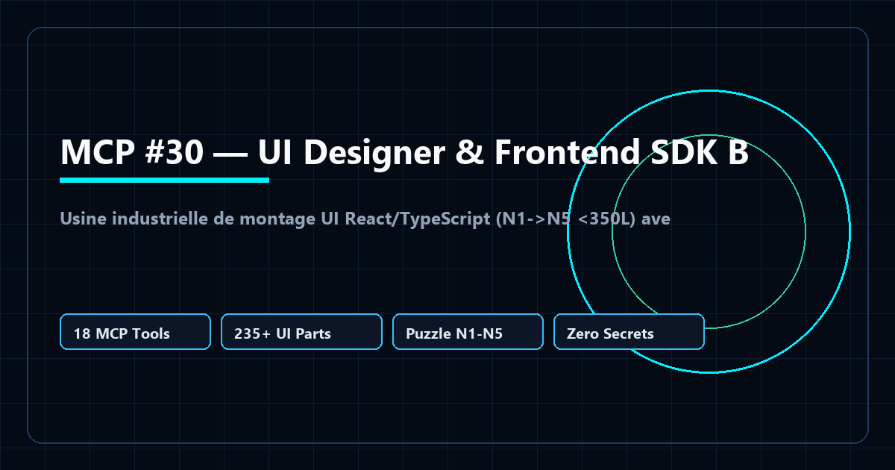
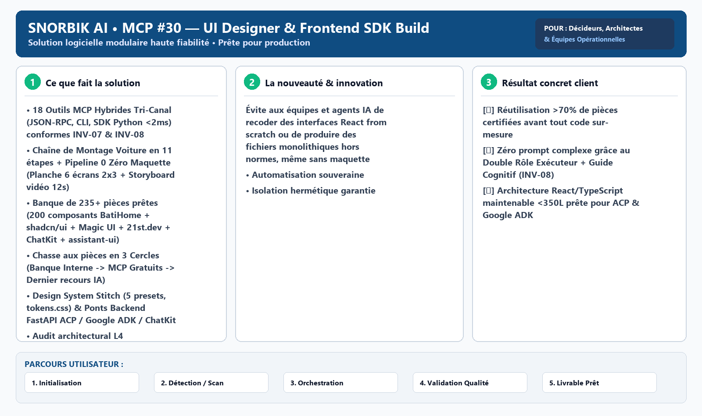
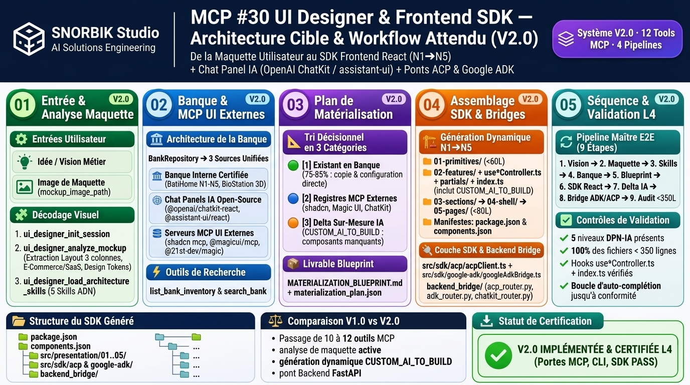

# MCP #30 — UI Designer & Frontend SDK Builder V3.0



> **Usine Industrielle de Montage UI React/TypeScript (`N1 ➔ N5 < 350L`) & SDK Agents IA (`ACP`, `Google ADK`, `OpenAI ChatKit`, `assistant-ui`)** — Banque de `235+` pièces prêtes, Chasse en 3 Cercles, Design System Stitch et méthode **AI Visual Prototyping** (*Zéro Maquette*).

## 💡 Ce que résout MCP #30

Évite aux équipes et aux agents IA de recoder des interfaces React *from scratch* ou de générer des fichiers monolithiques ingérables, même lorsque le projet démarre **sans aucune maquette préalable**.

## 🧩 Capacités & Fonctionnalités Clés

- **18 Outils MCP Hybrides Tri-Canal** (`JSON-RPC 2.0 stdio`, `CLI`, `SDK Python < 2 ms`) conformes aux doctrines **INV-07** (Pipelines Séquentielles Bipartites) et **INV-08** (Double Rôle *Exécuteur Déterministe + Guide Cognitif*).
- **Chaîne de Montage Voiture en 11 étapes :** Qualification d'archétype (`ecommerce_simple`, `ecommerce_complexe`, `hotel_reservation`, `ai_agent_console`, `saas_dashboard`) ➔ Cahier des charges des pages & diagrammes de séquence ➔ Design System **Stitch** (`tokens.css`) ➔ Décomposition `N1 ➔ N5` ➔ Chasse en 3 Cercles ➔ Matérialisation React/TypeScript + Pont FastAPI ➔ Audit L4.
- **Pipeline 0 « Zéro Maquette » (`AI Visual Prototyping`) :** Génère les prompts maîtres Phase 1 (planche `16:9` de **6 écrans en grille 2×3**) puis Phase 2 (storyboard vidéo **12 secondes** en tranches de `2s`) avant reconstruction en composants React réutilisables.
- **Banque de `235+` pièces prêtes :** `200` composants internes indexés + `35` briques open-source (`shadcn@latest mcp`, `@magicui/mcp`, `@21st-dev/magic`, `@openai/chatkit-react`, `@assistant-ui/react`) + `5` presets Stitch + templates `ACP` & `Google ADK`.
- **Chasse aux Pièces en 3 Cercles :**
  1. `CIRCLE_1_INTERNAL_BANK` (patrimoine interne `200` pièces)
  2. `CIRCLE_2_EXTERNAL_MCP_FREE` (registres open-source gratuits `shadcn`, `Magic UI`, `21st.dev`, `ChatKit`)
  3. `CIRCLE_3_CUSTOM_LAST_RESORT` (génération sur-mesure uniquement en dernier recours avec `use*Controller.ts` + `partials/` + `index.ts`)
- **Audit Architectural Automatique L4 :** Vérifie les 5 niveaux DPN-IA (`01-primitives` ➔ `05-pages`), la présence des manifestes (`package.json`, `components.json`), des hooks contrôleurs et du plafond strict **`< 350` lignes/fichier**.

## 📊 Infographie Commerciale & ROI



## 🏗️ Architecture & Workflow



## 🛠️ Liste Complète des 18 Outils MCP Exposés

1. `ui_designer_frontend_sdk_mcp_ping` — Sonde de santé mémoire vive (`< 1 ms`)
2. `ui_designer_frontend_sdk_mcp_get_pipelines` — Catalogue des 5 pipelines séquentielles conseillées
3. `ui_designer_init_session` — Initialisation de session (vision, maquette, protocoles IA)
4. `ui_designer_qualify_and_plan_pages` — Qualification archétype, pages & diagrammes de séquence
5. `ui_designer_extract_design_system` — Extraction Design System Stitch (`tokens.css`)
6. `ui_designer_analyze_mockup` — Analyse layout & zones UI de la maquette
7. `ui_designer_load_architecture_skills` — Chargement des 6 Skills ADN (`N1 ➔ N5`, `< 350L`, DDD)
8. `ui_designer_decompose_n1_to_n5` — Décomposition atomique des pièces `N1 ➔ N5`
9. `ui_designer_hunt_parts_3_circles` — Chasse aux pièces en 3 Cercles + taux de réutilisation
10. `ui_designer_list_bank_inventory` — Inventaire complet des `235+` pièces & presets
11. `ui_designer_search_bank` — Recherche ciblée par tags, features et protocoles
12. `ui_designer_generate_materialization_doc` — Blueprint d'assemblage chiffré
13. `ui_designer_materialize_frontend_sdk` — Génération du SDK React/TS + `package.json` + `components.json` + `tokens.css`
14. `ui_designer_generate_backend_bridge` — Génération des routeurs FastAPI (`ACP`, `Google ADK`, `ChatKit`)
15. `ui_designer_audit_architecture` — Audit de conformité L4 (`N1 ➔ N5`, hooks, `< 350L`)
16. `ui_designer_generate_phase1_design_prompt` — Zéro Maquette Phase 1 (Planche 6 écrans `2×3`)
17. `ui_designer_generate_phase2_video_prompt` — Zéro Maquette Phase 2 (Storyboard vidéo `12s`)
18. `ui_designer_frontend_sdk_mcp_run` — Exécuteur polymorphe direct One-Shot

## 🧪 Validation & Tests Automatisés

```bash
pytest tests/ -v
```
Suite L4 validée : **7/7 tests passants** (`SDK`, `Banque 235+`, `Scénario Hôtel 3 Cercles + Pages N5`, `Scénario Zéro Maquette Bio-Atlas`, `MCP JSON-RPC 18 outils INV-07`, `CLI`, `Serveur stdio JSON-RPC réel`).

---
*Documentation complète : [`README.md`](README.md) · Pack GEO/IA : [`llms.txt`](llms.txt) · Standard Showcase Zéro Secret.*
